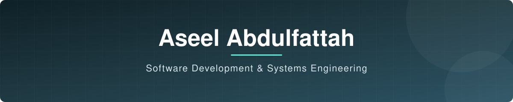

<div align="center">

**Information Technology student at Universitas Muhammadiyah Yogyakarta**
C# / .NET · C++ · SQL Server · Backend & Systems

<a href="https://www.linkedin.com/in/aseel-ahmed-523b3043a/"></a>
<a href="https://leetcode.com/u/A9eel/"></a>
<a href="mailto:asilalhashmi@gmail.com"></a>

</div>

<p align="center">
  <a href="#about">About</a> &nbsp;|&nbsp;
  <a href="#at-a-glance">At a Glance</a> &nbsp;|&nbsp;
  <a href="#featured-projects">Projects</a> &nbsp;|&nbsp;
  <a href="#tech-stack">Stack</a> &nbsp;|&nbsp;
  <a href="#how-i-work">How I Work</a> &nbsp;|&nbsp;
  <a href="#current-focus">Focus</a>
</p>

---

## About

I'm a self-taught programmer from Yemen, studying Information Technology at **UMY** (third semester, **GPA 3.65**).

I care most about understanding how software works underneath: how data moves over a network, how code is layered, and how a design holds up as a project grows. I build real applications to learn that, then review my own work honestly and redesign what I got wrong.

My foundation is **C#, .NET, C++ and SQL Server**, with OOP, 3-tier architecture and data structures. I'm steadily moving toward **backend and systems-level engineering**.

> **My loop:** Understand the fundamentals → Build the system → Review the mistakes → Improve the design.

Outside code, I volunteer as an English tutor and mentor students applying for scholarships.

---

## At a Glance

```csharp
public class Aseel : Developer
{
    public string University   => "Universitas Muhammadiyah Yogyakarta";
    public string[] Languages  => new[] { "C#", "C++", "SQL" };
    public string[] Interests  => new[] { "Backend", "Systems", "Database design" };
    public string Approach     => "Understand -> Build -> Review -> Improve";
    public string CurrentWork  => "DVLD";
}
```

---

## Featured Projects

<table>
<tr>
<td width="50%" valign="top">

### [Loan_Desk](https://github.com/Aseelcoding/Loan_Desk)
Equipment loan management system: loans, returns, payments, and compensation for lost equipment. My most carefully layered project, with a focus on exception handling.


</td>
<td width="50%" valign="top">

### [DVLD](https://github.com/Aseelcoding/DVLD)
Driving license management system with a 3-tier architecture, built across 128 source files over about three months.


</td>
</tr>
<tr>
<td width="50%" valign="top">

### [UniTrack_UMY](https://github.com/Aseelcoding/UniTrack_UMY)
Desktop app that pulls a UMY student's course data from the university's Moodle-based LMS (MyKlass) into one place.


</td>
<td width="50%" valign="top">

### [Scientific CLI Engine](https://github.com/Aseelcoding/Scientific-CLI-Engine-and-Expression-Parser)
Command-line expression parser with operator precedence, parentheses, variables and history.


</td>
</tr>
</table>

<details>
<summary><b>More projects</b></summary>

<br>

- **[Bank System](https://github.com/Aseelcoding/Bank-System-CPP)**: console banking system in C++ with clients, transactions, transfers, users, permissions and file persistence.
- **[Student Manager](https://github.com/Aseelcoding/Student_Manager)**: student management system in C# with CRUD operations and a 3-tier architecture.
- **[Contacts Management System](https://github.com/Aseelcoding/Contacts-Solution-WinForms-)**: WinForms contact manager with countries, profile images and SQL Server storage.

</details>

<p align="center"><a href="https://github.com/Aseelcoding?tab=repositories"><b>See all repositories</b></a></p>

---

## Tech Stack

<div align="center">


</div>

| | |
|---|---|
| **Languages** | C# · C++ · SQL |
| **Application development** | .NET · WinForms · ADO.NET · 3-tier architecture (UI / BLL / DAL) |
| **Databases** | SQL Server · relational design · SSMS |
| **Core concepts** | OOP · algorithms · data structures · clean code · exception handling |

---

## How I Work

| Principle | In practice |
|---|---|
| **Layered by default** | I separate UI, business logic and data access (UI / BLL / DAL) in DVLD and Loan_Desk, so each part can change without breaking the others. |
| **Review my own work** | When a project is done I audit it, list what is weak, and fix it before moving on. |
| **Learn by building** | For each new concept I pick a real project that forces me to use it properly, instead of only reading about it. |
| **Depth over quantity** | I would rather finish one hard project well than start five easy ones. |

---

## Current Focus

| Focus | Status |
|---|---|
| **DVLD**: continued development and improvements | In progress |
| **Systems programming track**: OS concepts and low-level C++ | Studying |
| **Problem solving**: LeetCode, mostly C++ | Ongoing |

---

## Problem Solving

<div align="center">
<a href="https://leetcode.com/u/A9eel/">

</a>
</div>

---

## Education & Certificates

- **Universitas Muhammadiyah Yogyakarta (UMY)**: Bachelor of Information Technology, third semester, GPA 3.65
- **Cisco Networking Academy**: IT Essentials 8 (2026, 70 hours)

---

## GitHub Activity

<div align="center">
<picture>
  <source media="(prefers-color-scheme: dark)" srcset="https://github-readme-stats.vercel.app/api?username=Aseelcoding&show_icons=true&theme=github_dark&hide_border=true&bg_color=0d1117" />
  
</picture>
<picture>
  <source media="(prefers-color-scheme: dark)" srcset="https://github-readme-stats.vercel.app/api/top-langs/?username=Aseelcoding&layout=compact&theme=github_dark&hide_border=true&bg_color=0d1117" />
  
</picture>
</div>

---

<div align="center">

**Open to talking about backend and systems programming.**
Feel free to reach out on [LinkedIn](https://www.linkedin.com/in/aseel-ahmed-523b3043a/) or by [email](mailto:asilalhashmi@gmail.com).

</div>


